# Laica S.p.A.: dossier, settore e piano di raccolta dati

**RevOps assessment B2B/B2C · Impresoft Engage · 25/09/2026**, preparato per il kick-off cliente del 02/10/2026.

*Uso interno.* Tra parentesi quadre il livello di confidenza delle affermazioni: **A** documentale · **B** dichiarato dall'owner · **C** riportato indirettamente · **D** stima Impresoft · **E** conflitto o dato ignoto. Il dettaglio di ogni affermazione è in `Registro_Affermazioni.md`.

---

## 0. Executive summary

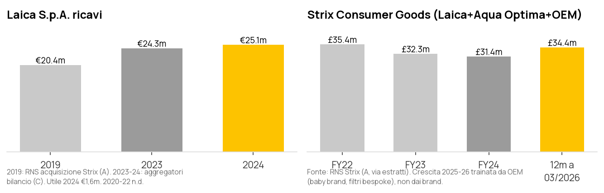

| 5 insight | 5 rischi | 5 ipotesi da validare con i dati |
|---|---|---|
| **1.** Laica fattura circa €25m ed è ferma rispetto al 2019 (€20,4m) [A/C]. La divisione Strix CG torna a crescere (+12%) **grazie all'OEM**, non al brand [A] | **1.** Nessun dato del cliente è ancora stato verificato su un sistema: tutti i pain sono dichiarati [B/C] | **H1.** La maggior parte del margine perso sta in Amazon (38-40% + ADS) e non nel D2C |
| **2.** Il business è **B2B2C**: circa 95% tra retail/GDO, OEM e forse Vendor; circa 5% online [B, definizione instabile] | **2.** WBS con **margine 0,0%** (€26.996,5 di costo su €27.000): non c'è spazio per un secondo giro di richieste dati [A] | **H2.** Il sottovuoto, non la filtrazione, genera il 66% dei ticket: l'automazione CS parte da lì |
| **3.** Il cliente finale non è di Laica: Amazon intermedia il B2C e HubSpot è una rubrica (20.000 anagrafiche, 15.820 con consenso) [B] | **3.** Nuovo CEO Strix dal 13/07 e revisione strategica in corso: il budget del piano triennale non è garantito [A] | **H3.** Il valore D2C sta nel **riacquisto dei filtri** (LTV), non nel margine della prima vendita |
| **4.** Il customer service è un collo di bottiglia misurabile: 6.435 ticket, 3,3-9,1 gg di risposta, 1 persona, nessun tool [B] | **4.** Conflitti tra fonti su D2C hardware, integrazione ERP e mix canali (9 claim di livello E) | **H4.** L'OEM, cioè la vera crescita, non ha né pipeline né CRM: il Revenue Model B2B pesa più del B2C |
| **5.** L'innovazione (PFAS, compatibili Brita) arriva sul mercato con 6 mesi di ritardo: è un problema di filiera dei contenuti (niente PIM), non solo di marketing [B] | **5.** Aspettative incompatibili: Milich vuole il D2C subito, ma manca un 3PL; lo SPICED dice FY29/30 | **H5.** Il 150 k€ di "riattivazione DB" è sovrastimato: base con consenso 15.820, riacquisto al 25% non verificato |

**Cosa serve entro il 09/10:** 49 richieste, di cui 29 Must, divise tra 9 referenti. 24 sono export diretti da sistemi noti (JGalileo, HubSpot, WooCommerce, Seller/Vendor Central, Amazon Ads); 25 sono domande di discovery. Vedi §7 e `Data_Request_LAica.xlsx`.

---

## 1. Fonti e affidabilità

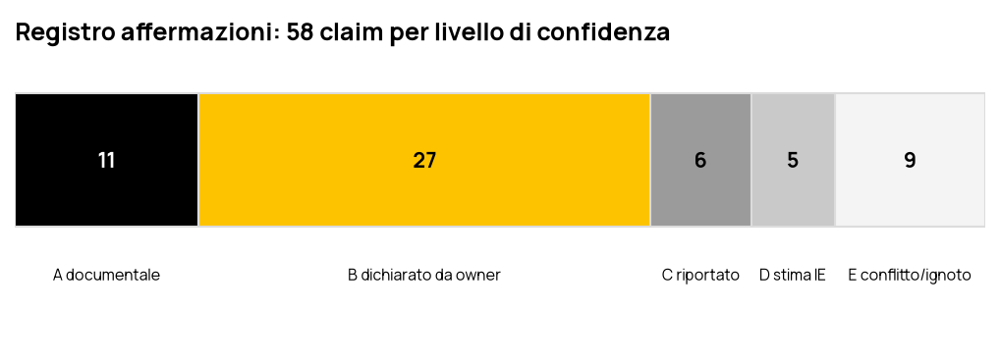

| Fonte | Tipo | Chi parla | Accesso |
|---|---|---|---|
| 4 call con il cliente (23/03, 01/04, 15/07, 03/08) + telefonata 20/07 | Bluedot | RD, NZ, EB, MM ↔ CAC, AB | **Negato** (le registrazioni sono di Campione) → uso i Meeting report IE |
| Risposte scritte al questionario (email NZ del 02/09, con EB e MM) | docx + ZIP | NZ, EB, MM | Allegati **non scaricabili** → numeri presi dallo SPICED del 07/09 |
| Meeting report, SPICED, presentazione 03/08, offerta firmata, WBS V1.1 | Drive | IE | Letti integralmente (`_sources/drive/`) |
| Call interne 21/07, 31/07, KOI 25/09 | Bluedot → `Transcript/` | CAC, AB, AM, VM | Trascritte integralmente |
| Bilanci, RNS Strix, tariffari Amazon, competitor | Web | — | Estratti di ricerca (`_sources/web/`), da confermare sul documento originale |

**Nota:** il KOI ripete i numeri dello SPICED a memoria e ne sbaglia 6 (tabella in fondo al registro). Per il kick-off valgono lo SPICED e le risposte scritte.

---

## 2. Dossier azienda

### 2.1 Identità e gruppo

| | |
|---|---|
| Società | LAICA S.p.A., P.IVA 00288500242, Barbarano Mossano (VI), socio unico, capitale €1m [A] |
| Storia | Fondata nel 1974 dalla famiglia Moretto ("Lavorazione Italiana Casalinghi"); seconda generazione e reparto R&D dal 1992; filiali in Taiwan (2007) e Spagna (2017) [A web] |
| Proprietà | Strix Group PLC (AIM: KETL) dal 26/10/2020, per €19,6m più earn-out fino a €12m [A] |
| Divisione | Strix Consumer Goods (Laica, Aqua Optima UK, OEM, produzione in Cina): circa £34m su 12 mesi, circa 1/3 del gruppo [A/B] |
| Contesto del gruppo | Billi venduta per £110m (01/2026), cassa netta £38,7m, nuovo CEO **Andy Rainforth** dal 13/07/2026, revisione strategica in corso [A] |
| Perimetro dell'assessment | Solo Laica S.p.A. e il brand Laica; esclusi Aqua Optima e Taiwan (RD, 20/07) [B] |

### 2.2 Come genera valore

```
R&D Italia (>100 brevetti, filtri bi-flux, PFAS)  →  Produzione Cina / filtri Made in Italy  →  4 motion di ricavo
                                                                                              │
   ┌───────────────────────┬──────────────────────────┬──────────────────────────┬───────────┴────────────┐
   │ RETAIL/GDO (B2B2C)    │ OEM WHITE LABEL (B2B)    │ AMAZON Vendor/Seller     │ SHOP D2C               │
   │ 10 agenzie IT, KA     │ prodotti su misura       │ IT ~tutto; FR/DE/ES/PL   │ solo ricambi e         │
   │ Unieuro/MediaWorld,   │ (baby, filtri bespoke)   │ "per vedere se vende"    │ consumabili;           │
   │ Tesco; distributori   │ deal 250k–4M€, 1–3 anni  │ 18% + 20-22% + ADS       │ 16 ordini/mese         │
   │ → volume, poco dato   │ → crescita, zero promo   │ → reach, niente dato     │ → dato, niente volume  │
   └───────────────────────┴──────────────────────────┴──────────────────────────┴────────────────────────┘
        ricorrenza: filtri e sacchetti sottovuoto (consumabili) → oggi catturata da Amazon e dai compatibili
```

**Proposta di valore dichiarata:** "Well-being at home", unica realtà che offre insieme filtrazione e piccoli elettrodomestici wellness/kitchen [B]. Nell'health (misuratori di pressione, dispositivi medici con codice Minsan) si scontra con Omron e Beurer. Il posizionamento esiste nei documenti interni ma non è comunicato al mercato (RD, 23/03) [B].

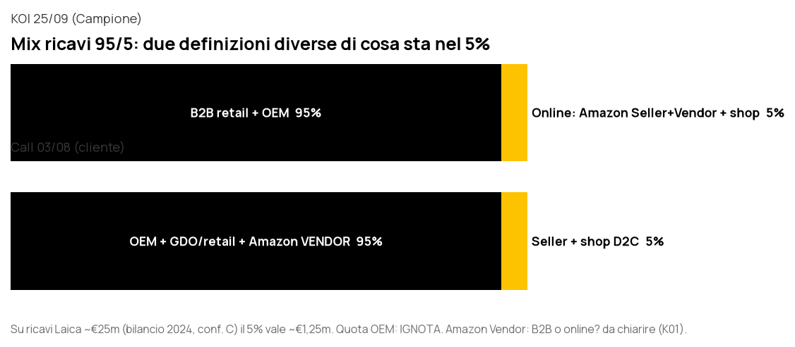

### 2.3 GTM as-is

| Area | Stato | Conf. |
|---|---|---|
| Vendite B2B | Italia: 5 agenzie per l'elettronica di consumo, 5 per il DIY, direzione diretta sui KA; UK: KA diretti (Tesco); Spagna: Sales Manager e agenzie; altri paesi: distributori. Ordini via email, portale B2B proprietario o EDI Vendor | B |
| OEM | Nessuna promozione ("non spendiamo niente", RD); nessun CRM; ciclo 1-3 anni | B |
| Marketing | Bellero (in azienda da 01/2026), agenzia MoMA ritenuta insoddisfacente, 99% del budget sul brand Laica, 40% del tempo sulla manutenzione dei canali | B |
| Amazon | 5 persone decidono senza coordinamento; AMS 595 k€/anno; 40 h/mese di promozioni manuali; il Seller è usato come leva negoziale contro il Vendor | B |
| Customer service | 1 persona (Zen) per il diretto, 2 per Amazon; email e form, nessuna chat né automazione | B |
| Dato | Nessun PIM, DAM o CDP; progetto PIM e progetto AI di previsione vendite bloccati da dati sporchi | B |

**Tech stack**

| Sistema | Uso | Integrazione | Owner |
|---|---|---|---|
| ERP JGalileo (SanMarco Informatica) | Ordini, fatture, anagrafiche | Seller: **live** (NZ) o **CSV** (SPICED) [E]; Vendor: CSV | Sella / Amm. |
| HubSpot | Rubrica consumatori IT, circa 20.000 contatti | Nessuna | Marketing |
| WordPress + WooCommerce | Sito e shop ricambi, 2 k€/anno | Nessuna con ERP | Marketing |
| Portale B2B proprietario | Ordini dei distributori | ERP? | IT |
| Seller Central, Vendor Central, Amazon Ads | Marketplace | CSV | Contin |
| App mobile (sviluppata in Cina) | Device connessi | ? | ? |
| Customer service | Email e form (tool **ignoto**) | Nessuna | Zen |

### 2.4 Stakeholder e SPICED

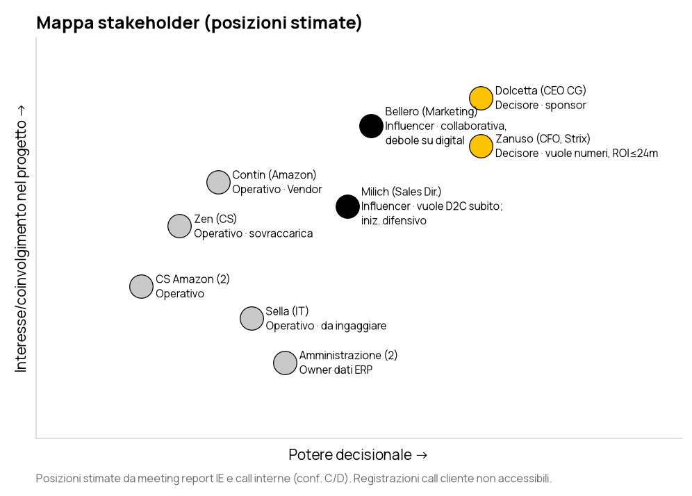

| S | P | I | C | D |
|---|---|---|---|---|
| Circa €25m, 95% B2B2C/OEM, piano 04/26–03/29 per l'Europa, cassa disponibile nel gruppo | Il cliente non è di Laica (Amazon); dato disordinato; CS manuale; go-to-market lento; OEM senza metodo | Margine Amazon 38-40%+ADS; LTV dei filtri perso a favore dei compatibili; 1 FTE CS; quota PFAS ceduta a Philips | Assessment da consegnare entro la W49 per il budget dell'anno fiscale; finestra di governance aperta dal cambio CEO Strix | Economic buyer RD, validatore NZ (payback ≤24m), influencer EB e MM; contratto firmato il 28/08 |

---

## 3. Dove si perde valore (dati dichiarati)

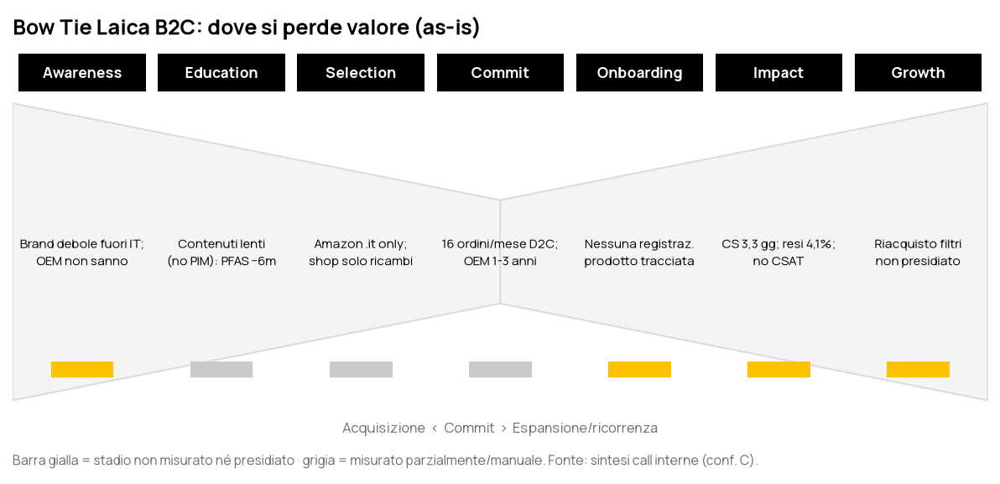
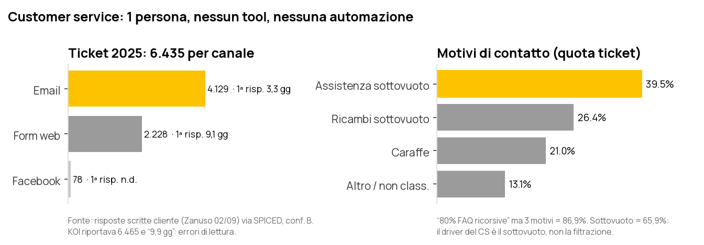
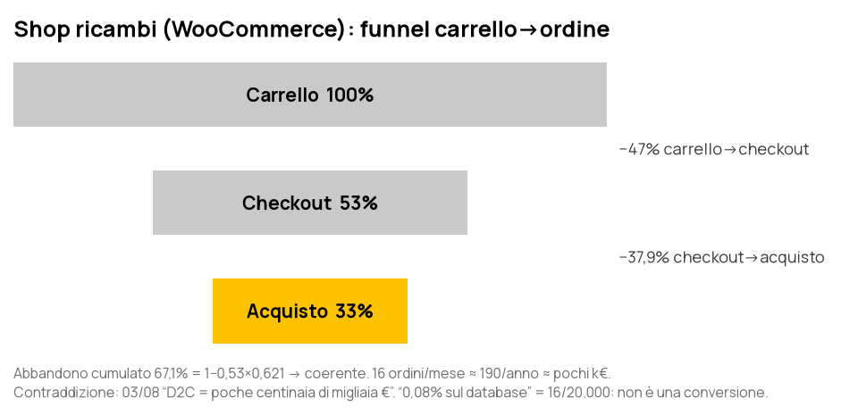
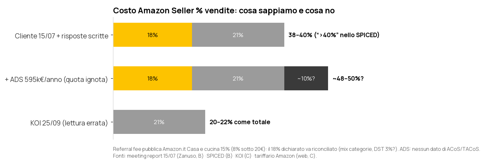
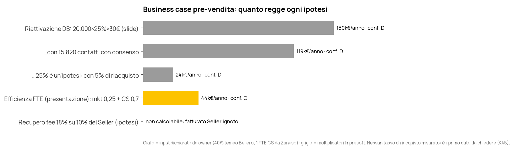

**Come leggerli:**
- I dati CS ed e-commerce sono coerenti al loro interno, quindi probabilmente estratti da un sistema: vanno solo confermati.
- I dati economici Amazon e il business case no. Il fatturato Seller, Vendor e D2C in euro è il dato mancante che blocca ogni calcolo di ROI (K01, K32, K33).

---

## 4. Settore e competitor

### 4.1 Mercato

| Segmento | Dimensione / trend | Conf. |
|---|---|---|
| Caraffe filtranti (mondo) | USD 0,9-3,5bn, CAGR 5-9%; Europa oltre il 40%; Germania primo mercato | C |
| Soluzioni filtranti Italia | Mercato +150% dal 2018; le usano 39 italiani su 100, le caraffe 14 su 100 (Brita Italia) | C |
| Piccoli elettrodomestici Italia 2025 | circa €2,3bn, +5,2%, online al **38,3%** | B |
| Misuratori di pressione Europa | circa USD 1,1bn | C |
| E-commerce B2C Italia 2025 | €40bn di prodotti, penetrazione 11,2%; elettronica al 43% | B |

**Tre dinamiche che pesano su Laica:**
1. **Guerra dei compatibili.**
   - Brita, Philips (Micro X-Clean), Wessper e Aqua Optima vendono filtri compatibili con altre caraffe.
   - Laica risponde con il bi-flux universal "LAICA-Key", compatibile Brita.
   - In Germania Brita ha ottenuto il divieto di pubblicizzare la compatibilità (causa contro Aqua Select) [B]: **rischio legale sui claim in DE**.
2. **Retail in consolidamento.** Unieuro è passata a Fnac Darty; MediaWorld/Ceconomy va verso JD.com [B]. Il potere negoziale dei KA cresce.
3. **Amazon come porta d'ingresso nei nuovi paesi.** Il Vendor chiede co-op del 5-15% e blocca le vendite durante la negoziazione (NZ) [B/C].

### 4.2 Competitor

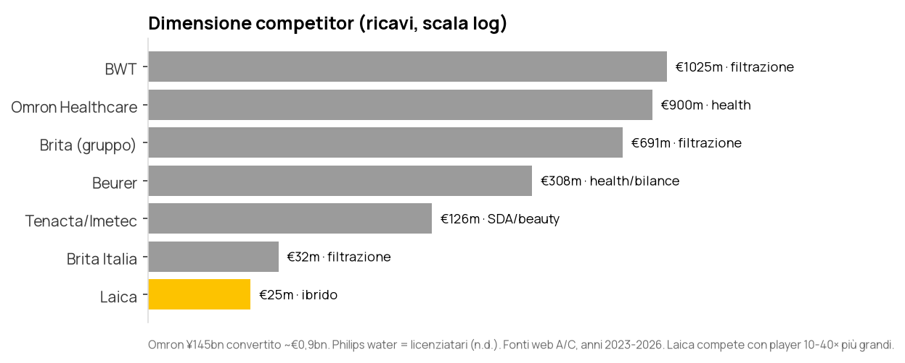

| Player | Categoria | Posizionamento / canali | Differenziatore rispetto a Laica |
|---|---|---|---|
| **Brita** (DE) | Filtrazione | Leader; GDO, Amazon, subscription; €691m | Brand e potenza di comunicazione; brevetti sui compatibili |
| **Philips water** (licenziatari) | Filtrazione + SDA | Brand globale; primo a comunicare sul PFAS | Notorietà; compatibili Brita/Laica |
| **BWT** (AT) | Filtrazione | Premium, cartucce al magnesio; circa €1bn | Tecnologia e canale professionale |
| **Aqua Optima** (Strix, UK) | Filtrazione | Compatibili oltre il 90% delle caraffe; Tesco, Argos | Stesso gruppo: rischio di cannibalizzazione in UK |
| **Wessper** (PL) | Filtrazione | Price fighter su Amazon, Leroy Merlin, Kaufland | Prezzo (cfr. filtro cinese a €2,83 contro bi-flux a €5,37) |
| **Omron** (JP) | Health | Leader nei misuratori di pressione; farmacia | Validazione clinica, brand medicale |
| **Beurer** (DE) | Health / bilance | €308m; ampia gamma | Catalogo e distribuzione UE |
| **Imetec/Tenacta** (IT) | SDA / beauty | €126m (+37%) | Forza in GDO Italia |

**Lettura:** Laica compete con player 10-40 volte più grandi su ciascuna categoria. Il suo vantaggio può stare solo in (a) R&D e certificazioni (PFAS), (b) catalogo ibrido "well-being", (c) capacità OEM. Nessuno dei tre è misurato né comunicato oggi.

---

## 5. Come si struttura il GTM nelle aziende di questo tipo

Consumer durables, small appliances e brand B2B2C con OEM.

| Funzione | Benchmark di settore | Laica oggi | Gap |
|---|---|---|---|
| Key Account / Trade | KAM per insegna, JBP annuali, trade terms codificati, sell-out settimanale | KA gestiti dalla direzione, agenzie plurimandatarie | Nessun sell-out né trade spend misurato |
| Category / Trade marketing | Planogrammi, promo calendar, ROI promo | 40 h/mese di promo Amazon manuali | Nessun calendario promo integrato tra retail e Amazon |
| E-commerce e marketplace | Team dedicato (Amazon 1P/3P, retail media, DTC), retail media ACoS/TACoS | 5 persone non coordinate | Nessun owner unico, nessun P&L di canale |
| OEM / B2B BD | Pipeline CRM, ABM, fiere, stage-gate progetto | Nessun CRM, zero promozione | Pipeline invisibile |
| Customer care | Omnicanale, ticketing, knowledge base, chat/AI, CSAT | Email, 1 FTE, 3,3-9,1 gg | Tool, KB, automazione |
| Content/PIM | PIM/DAM come fonte unica, syndication feed | Niente PIM, mesi per una scheda | Time-to-market |
| RevOps / BI | Data model unico cliente-ordine-prodotto, dashboard per canale | Excel, dati "non azionabili" | Tutto |

**KPI che guardano i best-in-class, confrontati con Laica:**

| KPI | Benchmark | Laica |
|---|---|---|
| Conversion rate e-commerce | 1-3% (Italia circa 1%) [C] | Non misurato (0,08% non è un CR) |
| Prima risposta via email | Meno di 4 h i migliori, 7-12 h la media [C] | 3,3 gg email, 9,1 gg form |
| TACoS Amazon | 5-10% prodotti maturi, 15-25% al lancio [C] | Ignoto (595 k€ di spesa, GMV ignoto) |
| OTIF verso retail | 95-98% (Walmart 98%) [C] | Non misurato |
| Trade spend | Circa 20% dei ricavi; 59% delle promo in perdita [B] | Non misurato |
| Riacquisto dei consumabili | KPI principale per i brand di filtrazione (subscription) | Non misurato |

---

## 6. Implicazioni per l'assessment

1. **Revenue Model B2B prima del B2C.** Il 95% dei ricavi e la crescita (OEM) stanno lì. Senza export ERP per canale il WS#1 non si può fare.
2. **Il B2C si gioca sui consumabili.** Serve un journey Amazon → registrazione prodotto → riacquisto filtri su D2C. La KPI chiave è il tasso di riacquisto, non il conversion rate.
3. **Il customer service è la prima quick win misurabile.** Con l'export della casella email si classificano i ticket con l'AI e si costruisce la knowledge base (sottovuoto).
4. **Il business case va ricostruito su dati.** Le cifre di 150 k€ e 43,7 k€ restano ipotesi finché non arrivano K01, K33, K45 e K60.
5. **Politica di canale.** Le regole tra D2C, agenti, distributori e Amazon devono esistere prima del D2C hardware, altrimenti la rete fa resistenza (rischio 03/08).

---

## 7. Raccolta dati: KPI e richieste

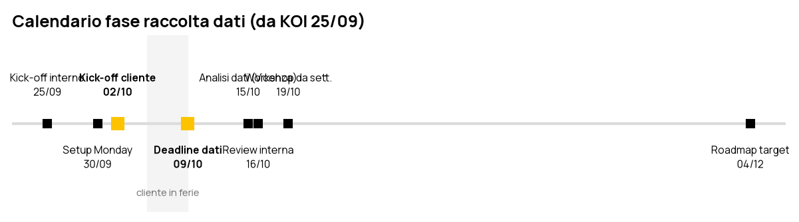

| Livello | N. KPI | Esempi |
|---|---|---|
| **L1 Business** | 18 | Ricavi e margine per canale, costo totale Amazon, crescita per paese, win rate OEM, LTV filtri, CAC D2C |
| **L2 Servizio** | 11 | OTIF, resi, sell-out, ticket/1000 unità, tempi di risposta, motivi di contatto, rating |
| **L3 Operativo** | 20 | Traffico, funnel, ACoS/TACoS, pipeline OEM, ore manuali, qualità del dato, time-to-market |

**Richieste per sistema (export diretti):**
- **JGalileo**: righe fattura e note di credito 2023→oggi con canale, paese, agente, SKU e costo; anagrafica clienti con tipologia (flag OEM); ordini con date richiesta/evasione; provvigioni agenti.
- **HubSpot**: contatti con consenso, fonte e lifecycle; oggetti Companies, Deals e Tickets; licenza e utenti.
- **WooCommerce**: ordini 2023→oggi con id cliente stabile; carrelli abbandonati.
- **Seller/Vendor Central**: Business Report per ASIN e marketplace; settlement 2025; Retail Analytics Vendor; resi e Voice of the Customer.
- **Amazon Ads**: campagne SP/SB/SD per mese e marketplace 2025→oggi.

**Domande di discovery (sistema ignoto):**
- strumento del customer service ed export della casella;
- analytics (GA4?) e Search Console;
- registro delle opportunità OEM;
- sell-out dai retailer o da panel;
- trade spend;
- costo landed per SKU e conto economico per canale;
- piano triennale con i target;
- timeline dei lanci recenti (PFAS).

**File:**
- `Data_Request_LAica.xlsx`: un foglio per referente, con stato e colonne da compilare;
- `KPI_Tree.md`: albero causale e copertura del Bow Tie;
- `Agenda_Data_Discovery.md`: domande per persona e 9 conflitti da chiarire al kick-off.

**Allineamento WBS:** tutto viene raccolto nella fase **1.1 Kick-off e analisi preliminare** (3 gg di back office). Ogni KPI ha la sua fase di utilizzo: 1.2 Revenue Model, 1.3 ICP/Journey, 1.4 Process, 1.6 Tech/Data, 1.7 Data model.

---

*Appendice: `Transcript/` (3 call interne integrali), `_sources/drive/` (21 documenti), `_sources/web/web_research.md` (circa 80 fatti con URL), `Registro_Affermazioni.md` (58 affermazioni).*
